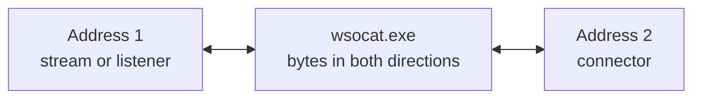

# wsocat

**Connect Windows endpoints and relay bytes between them.**

`wsocat` is a small, Windows-only command-line relay inspired by `socat`. Join
two streams in one command: connect a local port to a service, bridge a Windows
named pipe to TCP, talk to a Hyper-V socket, or send a stream through TLS. It
ships as single portable executable.



## Install

### Use a release build

When a release is available, download `wsocat.exe` from this repository's
**Releases** page. Put it in a folder you control and run it from there, or add
that folder to your `PATH` to call `wsocat` from any terminal. The executable
is portable: no installer, Go runtime, or .NET runtime is needed.

Check that it starts with:

```powershell
.\wsocat.exe --help
```

### Build from source

On Windows, install Go 1.27 or newer, clone or download this repository, then
open PowerShell in the project folder and run:

```powershell
.\build.ps1
```

The script creates `dist\wsocat.exe` (Windows amd64 by default). The build
script also accepts `-Architecture arm64` or `-Architecture 386`.

## Quick start

Forward a local-only port to an application listening on port 3000:

```powershell
.\wsocat.exe TCP-LISTEN:127.0.0.1:8080 TCP:127.0.0.1:3000
```

In another terminal, connect through the relay:

```powershell
curl.exe http://127.0.0.1:8080/
```

You can also connect your terminal directly to a TCP service:

```powershell
.\wsocat.exe STDIO TCP:127.0.0.1:9000
```

## Use cases

### Forward TCP connections

Connect a local port to a service on another host:

```powershell
.\wsocat.exe TCP-LISTEN:127.0.0.1:8080 TCP:10.0.0.25:80
```

Or connect standard input/output to a TCP service:

```powershell
.\wsocat.exe STDIO TCP:example.net:9000
```

For a listener reachable by other computers, bind to an appropriate network
address. `TCP-LISTEN:8080` listens on all interfaces; use
`TCP-LISTEN:127.0.0.1:8080` when access should stay on this computer.

### Connect to a TLS service

`TLS` opens a verified TLS client connection. Certificates are checked against
the Windows system trust roots, and the address hostname is used for SNI and
hostname validation.

```powershell
# Accept local connections and forward them over TLS to an API
.\wsocat.exe TCP-LISTEN:127.0.0.1:8443 TLS:api.example.net:443

# Use a DNS name for SNI and certificate validation when connecting by IP
.\wsocat.exe TLS:10.0.0.25:443,servername=api.example.net STDIO

# Add a private CA certificate to the system trust roots
.\wsocat.exe TLS:api.internal:443,cafile=C:\certs\company-root.pem STDIO
```

wsocat relays application bytes as-is. It does not rewrite HTTP headers such as
`Host`. `TLS` is an outbound connector; inbound TLS termination is not currently
supported.

### Bridge Windows named pipes

Accept local named-pipe clients and forward each connection to TCP:

```powershell
.\wsocat.exe NPIPE-LISTEN:appBridge TCP:127.0.0.1:9000
```

Connect to a pipe on another Windows computer:

```powershell
.\wsocat.exe NPIPE:BuildServer:BuildPipe STDIO
```

`NPIPE-LISTEN` accepts local clients only. Named-pipe access is also subject to
the Windows pipe security settings.

### Bridge Windows AF_UNIX sockets

Forward a Windows named pipe to a local AF_UNIX socket:

```powershell
.\wsocat.exe NPIPE-LISTEN:unixBridge UNIX:C:\Temp\service.sock
```

Or accept AF_UNIX clients and forward them to TCP:

```powershell
.\wsocat.exe UNIX-LISTEN:C:\Temp\service.sock TCP:127.0.0.1:9000
```

AF_UNIX availability depends on the Windows version.

### Connect WSL to Windows

Run a command inside a WSL distribution and bridge its standard streams:

```powershell
.\wsocat.exe STDIO WSL:cat,distribution=Ubuntu
```

Bridge a Windows named pipe to a Unix socket inside WSL (requires `socat` in
the selected distribution):

```powershell
.\wsocat.exe NPIPE-LISTEN:wslBridge 'WSL:"socat STDIO unix-connect:/run/service.sock",distribution=Ubuntu'
```

The `distribution` and `user` options are optional. If omitted, WSL uses its
default distribution and user. `wsl.exe` must be installed and available.

### Connect to a Hyper-V socket

Connect to VSOCK port 2761 in a configured VM:

```powershell
.\wsocat.exe STDIO HVSOCK:0cb41c0b-fd26-4a41-8370-dccb048e216e:vsock-2761
```

Or listen for a Hyper-V socket connection and forward it to a local service:

```powershell
.\wsocat.exe HVSOCK-LISTEN:WILDCARD:vsock-2761 TCP:127.0.0.1:8080
```

The VM identifier can be a GUID or `ZERO`, `WILDCARD`, `BROADCAST`,
`LOOPBACK`, `CHILDREN`, or `PARENT`. The `vsock-N` form maps a Linux VSOCK
port to its Hyper-V service identifier. A live connection requires a
configured host/guest endpoint and an available service.

### Connect a process

Bridge a process's standard input/output to a TCP service:

```powershell
.\wsocat.exe EXEC:C:\Windows\System32\whoami.exe TCP:127.0.0.1:9000
```

`EXEC` starts the named program directly; it does not insert a command shell.
Child-process stderr is written to wsocat's stderr. Use an explicit `cmd.exe`
or PowerShell command if a shell is needed.

### Relay a serial port

Connect a Windows COM port to standard input/output:

```powershell
.\wsocat.exe SP:COM1 STDIO
```

Set the line configuration when needed:

```powershell
.\wsocat.exe SP:COM5,baudrate=115200,parity=Even,databits=8,stopbits=One STDIO
```

Defaults are 9600 baud, no parity, 8 data bits, and one stop bit. Supported
parity values are `None`, `Odd`, `Even`, `Mark`, and `Space`; supported data
bits are 5–8; stop bits are `One`, `OnePointFive`, and `Two`. Numeric enum
values are accepted too. COM10 and higher are supported. The port must exist
and be available for exclusive access. Five data bits cannot be combined with
two stop bits, and 1.5 stop bits require five data bits.

## Address reference

The command takes exactly two addresses:

```text
wsocat.exe [address1] [address2]
```

`address1` is either a stream or a listener. `address2` must be a connector.
Listener addresses are allowed only as `address1`. Each accepted listener
connection gets its own connection to `address2`; up to 128 sessions can run
at once. Press Ctrl+C to stop.

| Address | Role | Purpose |
| --- | --- | --- |
| `STDIO` | Either side | Standard input and output |
| `TCP:host:port` | Connector | Connect to TCP; IPv6 hosts use `[::1]:port` form |
| `TCP-LISTEN:host:port` | Address 1 only | Accept TCP clients |
| `TLS:host:port[,servername=...][,cafile=...]` | Connector | Verified TLS client connection |
| `NPIPE:name` | Connector | Connect to a local named pipe |
| `NPIPE:server:name` | Connector | Connect to a remote named pipe |
| `NPIPE-LISTEN:name` | Address 1 only | Accept local named-pipe clients |
| `UNIX:path` | Connector | Connect to a Windows AF_UNIX socket |
| `UNIX-LISTEN:path` | Address 1 only | Accept AF_UNIX clients |
| `EXEC:program [args...]` | Either side | Run a process and relay its standard streams |
| `WSL:command[,distribution=...][,user=...]` | Either side | Run a command through WSL |
| `HVSOCK:vm-id:service-id` | Connector | Connect to a Hyper-V socket |
| `HVSOCK-LISTEN:vm-id:service-id` | Address 1 only | Listen on a Hyper-V socket |
| `SP:COMx[,baudrate=...][,parity=...][,databits=...][,stopbits=...]` | Either side | Open a Windows serial port |

## Development

Build and test instructions, plus notes about optional WSL, Hyper-V, and serial
hardware checks, are in [DEVELOPMENT.md](DEVELOPMENT.md).
